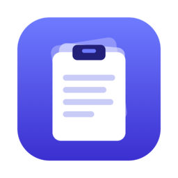
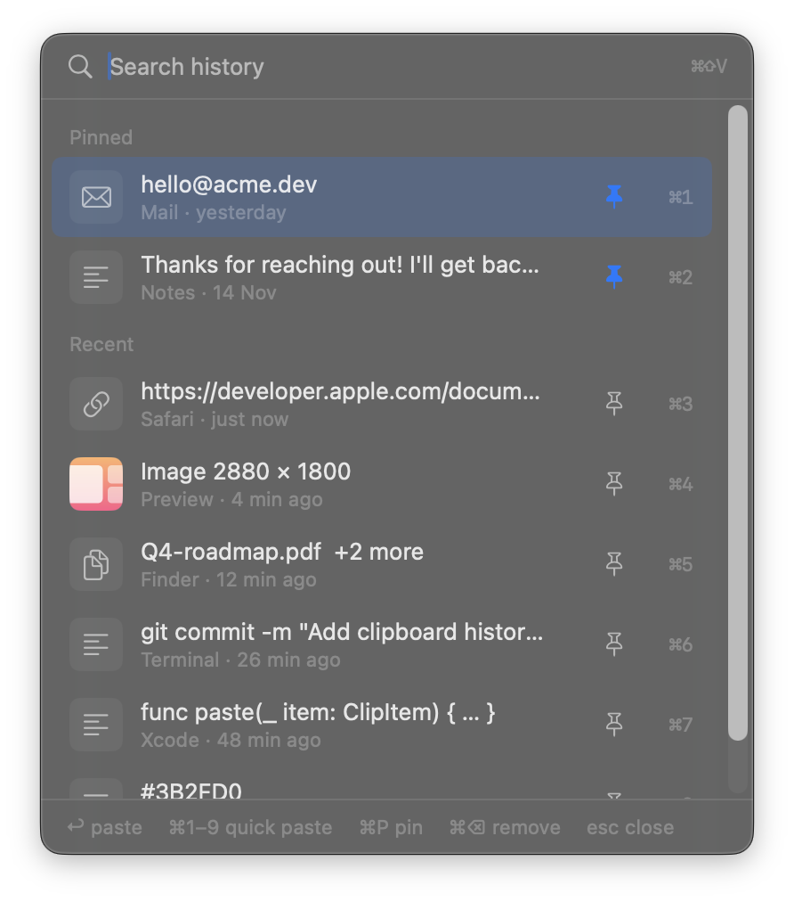

<p align="center">
  
</p>

<h1 align="center">ClipHistory</h1>

<p align="center">
  <strong>Windows-style clipboard history for macOS.</strong><br>
  Press <kbd>⌘</kbd><kbd>⇧</kbd><kbd>V</kbd>, pick something you copied earlier, and it's pasted where you're typing.
</p>

<p align="center">
  
  
  
  
</p>

<p align="center">
  
</p>

---

If you've used <kbd>Win</kbd>+<kbd>V</kbd> on Windows, you already know how this works. ClipHistory
keeps everything you copy and opens a small popup right under your text cursor. Type
to filter, press <kbd>↩</kbd>, and the item is pasted into the app you were using. You never
leave the app you're in.

## Features

- **Popup at the cursor.** Opens where you're typing, or under the mouse when the app doesn't say where the cursor is.
- **Text, images and files.** Keeps rich text formatting, screenshots and images with thumbnails, and files copied in Finder.
- **Instant search.** Start typing to filter by content or by the app you copied from.
- **Pins.** Pinned items stay at the top and are never trimmed.
- **Keyboard first.** Arrow keys, <kbd>↩</kbd> to paste, <kbd>⌘1</kbd>–<kbd>⌘9</kbd> for the top nine.
- **No duplicates.** Copying something again moves it back to the top.
- **Private by design.** Runs locally with no network access. Copies that password managers mark as secret are never stored.
- **Small and native.** Swift, SwiftUI and AppKit with no third-party dependencies. It lives in the menu bar and has no Dock icon.

## Keyboard

| Key | Action |
| --- | --- |
| <kbd>⌘</kbd><kbd>⇧</kbd><kbd>V</kbd> | Open or close the history (changeable in Settings) |
| <kbd>↑</kbd> <kbd>↓</kbd> | Move the selection |
| <kbd>↩</kbd> | Paste the selected item |
| <kbd>⌘1</kbd> … <kbd>⌘9</kbd> | Paste that row directly |
| <kbd>⌘P</kbd> | Pin or unpin |
| <kbd>⌘⌫</kbd> | Remove from history |
| <kbd>esc</kbd> | Close |

Clicking a row pastes it too.

## Install

ClipHistory is built from source. You need **macOS 14 or later**, **Xcode** and
[XcodeGen](https://github.com/yonaskolb/XcodeGen).

```bash
brew install xcodegen
git clone https://github.com/acermez/ClipHistory.git
cd ClipHistory
scripts/build.sh
```

`scripts/build.sh` builds a Release copy, signs it, installs it to
`~/Applications/ClipHistory.app` and starts it. If you have an *Apple Development*
certificate (free with any Apple ID in Xcode), the script signs with it, and macOS
then keeps the app's permissions across rebuilds. Without one it signs ad-hoc, and
you'll be asked for Accessibility again after each rebuild.

Run the unit tests with `scripts/test.sh`.

### First launch: two permissions

| Permission | Why | Without it |
| --- | --- | --- |
| **Accessibility** | Presses <kbd>⌘V</kbd> for you and finds the text cursor | Picking an item copies it and you press <kbd>⌘V</kbd> yourself |
| **Paste from other apps** (macOS 16+) | Lets the app read what you copy without asking every time | macOS shows an alert on each copy |

Both are in **System Settings → Privacy & Security**. ClipHistory's Settings window
shows whether each one is on and has a button to open the right page.

## Settings

Open them from the menu-bar icon → **Settings…**

- **Shortcut:** <kbd>⌘⇧V</kbd>, <kbd>⌥⌘V</kbd>, <kbd>⌃⌘V</kbd> or <kbd>⌃⇧V</kbd>
- **History size:** 50 to 1,000 items (pinned items don't count)
- **Open at login**
- **Clear history** (keeps pinned items)

`cliphistory://show` opens the popup from Shortcuts, Raycast, Alfred or a script.

## Privacy

- Everything stays on your Mac in `~/Library/Application Support/ClipHistory/`, a
  folder only your user account can read. The app makes no network requests.
- Copies marked as secret by password managers are skipped, following the
  [nspasteboard.org](http://nspasteboard.org) convention (`org.nspasteboard.ConcealedType`,
  `TransientType`, `AutoGeneratedType`). 1Password's own marker is skipped too.
- Anything larger than 50 MB is not stored.

## How it works

| Piece | How |
| --- | --- |
| Watching the clipboard | macOS has no "clipboard changed" event, so the app checks `NSPasteboard.changeCount` twice a second and only reads data when it changes |
| Global shortcut | Carbon `RegisterEventHotKey`, which needs no permission |
| Popup | A non-activating `NSPanel`, so the app you're typing in keeps focus |
| Cursor position | The Accessibility API (`kAXBoundsForRangeParameterizedAttribute`) |
| Pasting | Writes every saved format back to the clipboard, then sends <kbd>⌘V</kbd> with `CGEvent` using the right key for your keyboard layout |
| Storage | `index.json` for metadata, one binary plist per item for the data, PNG thumbnails for images |

```
ClipHistory/
├── App/AppDelegate.swift          menu bar, wiring, paste flow
├── Models/
│   ├── ClipCapture.swift          turns raw clipboard data into an item
│   ├── ClipItem.swift
│   └── HistoryStore.swift         history on disk, pins, search, trimming
├── Services/
│   ├── PasteboardMonitor.swift    watches the clipboard
│   ├── HotKey.swift               global shortcut
│   ├── CaretLocator.swift         finds the text cursor
│   ├── Paster.swift               writes back and presses ⌘V
│   └── AppSettings.swift
└── UI/                            popup panel, list and Settings (SwiftUI)
```

For development, `CLIPHISTORY_DATA_DIR=/some/folder` makes the app use another
history folder.

## Uninstall

Quit ClipHistory from its menu-bar icon, then:

```bash
rm -rf ~/Applications/ClipHistory.app "$HOME/Library/Application Support/ClipHistory"
defaults delete com.aminemezghani.ClipHistory
```

Remove it from System Settings → Privacy & Security → Accessibility as well.

## License

[MIT](LICENSE)
